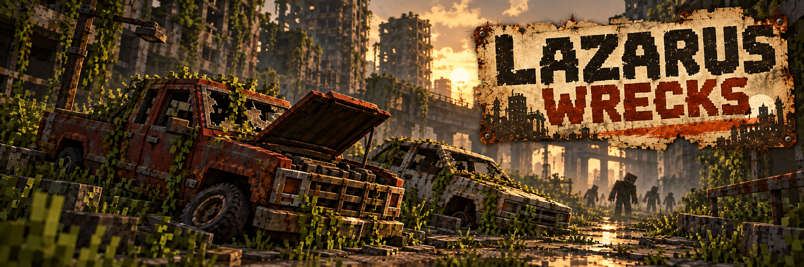

<p align="center">
  
</p>

<p align="center">
  
  
  
  
</p>

# Lazarus Wrecks

**Lazarus Wrecks** é um mod para Minecraft Forge 1.20.1 criado para o modpack **Project Lazarus**. Ele espalha veículos abandonados pelas ruas das cidades pós-apocalípticas. Os carros são entidades reais do **Immersive Vehicles**, com modelos do **MTS Official Pack**: você pode interagir com eles e buscar peças para recuperá-los.

As ruas deixam de parecer vazias sem virar um depósito de veículos prontos para dirigir. Cada carro surge avariado, sem combustível e sem motor; alguns estão também sem uma roda. O mod não constrói carros usando blocos do Minecraft.

---

## Sumário

- [Veículos nas ruas](#veículos-nas-ruas)
- [Onde e quando surgem](#onde-e-quando-surgem)
- [Configuração e comando](#configuração-e-comando)
- [Instalação](#instalação)
- [Créditos e licença](#créditos-e-licença)

---

## Veículos nas ruas

O gerador usa modelos civis do MTS Official Pack, incluindo **Scout**, **Mercedes 230** e **Mustang 1969**, em várias cores. O veículo recebe dano, uma bateria vazia e um tanque vazio. O motor é removido e existe uma pequena chance de faltar uma roda.

Os carros podem ser reparados com as peças e os sistemas do Immersive Vehicles. O Lazarus Wrecks não substitui o funcionamento dos veículos nem acrescenta receitas próprias.

---

## Onde e quando surgem

- Somente no **Overworld**, em ruas geradas pelo **CityWorld** no estilo apocalíptico.
- A chance padrão é de **25% por trecho de rua próximo a construções** e **5% por trecho afastado**.
- O gerador procura um espaço plano, seco e sem obstáculos. Se não encontrar, ignora aquele trecho.
- A geração normal acontece em **chunks novos**. Para procurar veículos em ruas já carregadas, use o comando de teste abaixo.

Os carros feitos de blocos pelo protótipo 0.1.x, se já estiverem salvos em um mundo, continuam como blocos até serem removidos. A versão 0.2.0 não gera mais esses protótipos.

---

## Configuração e comando

Depois de abrir o jogo uma vez, ajuste `config/lazaruswrecks-common.toml`:

| Opção | Padrão | Efeito |
|---|---:|---|
| `enabled` | `true` | Ativa a geração em chunks novos |
| `urbanChance` | `0.25` | Chance por trecho de rua perto de construções |
| `ruralChance` | `0.05` | Chance por trecho de rua afastado |

Com permissão de operador, `/lazaruswrecks backfill 8` verifica os chunks **já carregados** em um raio de oito chunks ao redor do jogador. O comando não duplica veículos em trechos já registrados como atendidos. Os resultados de cada lote aparecem em `logs/latest.log`.

---

## Instalação

### Requisitos

- **Minecraft 1.20.1**
- **Minecraft Forge 47.x** (desenvolvido com 47.4.10)
- **Java 17**
- **CityWorld 6.3.0** para Minecraft 1.20.1
- **Immersive Vehicles 24.0.0** e **MTS Official Pack V29** para Minecraft 1.20.1

### Jogadores e servidores

1. Baixe [`lazaruswrecks-0.2.0.jar`](dist/lazaruswrecks-0.2.0.jar) e instale os mods exigidos acima.
2. Coloque o JAR na pasta `mods` do perfil. No CurseForge, clique com o botão direito no perfil e escolha **Open Folder**.
3. Em multiplayer, instale a mesma versão no servidor e em todos os clientes.
4. Remova qualquer JAR antigo `lazaruswrecks` antes de atualizar e reinicie o Minecraft.

### Compilar a partir do código

Com JDK 17 instalado, execute na raiz do projeto:

```bash
gradlew build -PcityworldJar=<caminho-absoluto-do-CityWorld.jar> -PmtsJar=<caminho-absoluto-do-Immersive-Vehicles.jar>
```

O JAR compilado fica em `build/libs/`. Os caminhos dos dois mods também podem ser informados pelas variáveis de ambiente `CITYWORLD_JAR` e `MTS_JAR`.

---

## Créditos e licença

- Desenvolvido por **Kaique Melo** para o **Project Lazarus**.
- Os modelos de veículos pertencem ao **MTS Official Pack**; a geração usa a API do **Immersive Vehicles** e as ruas do **CityWorld**.
- Banner: arte gerada com IA para o Lazarus Wrecks.
- Não é afiliado à Mojang ou à Microsoft.

**Licença:** All Rights Reserved.
